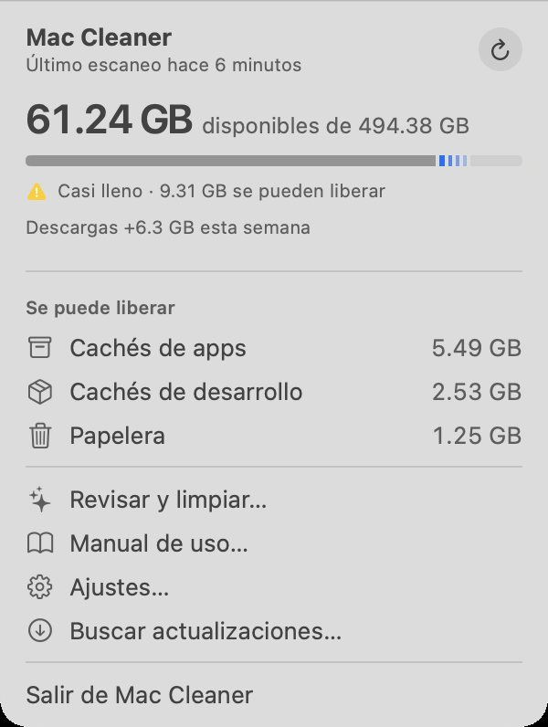
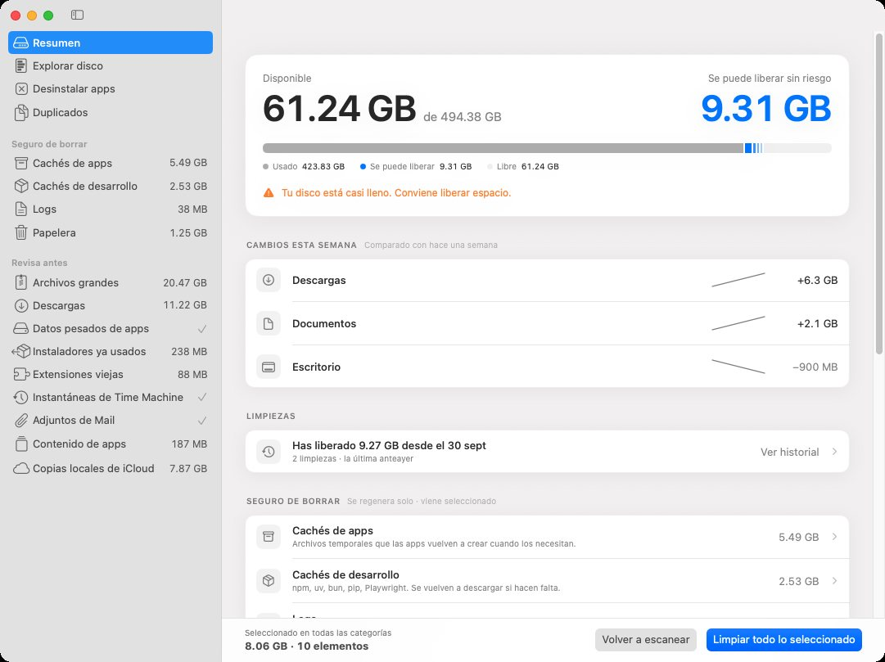
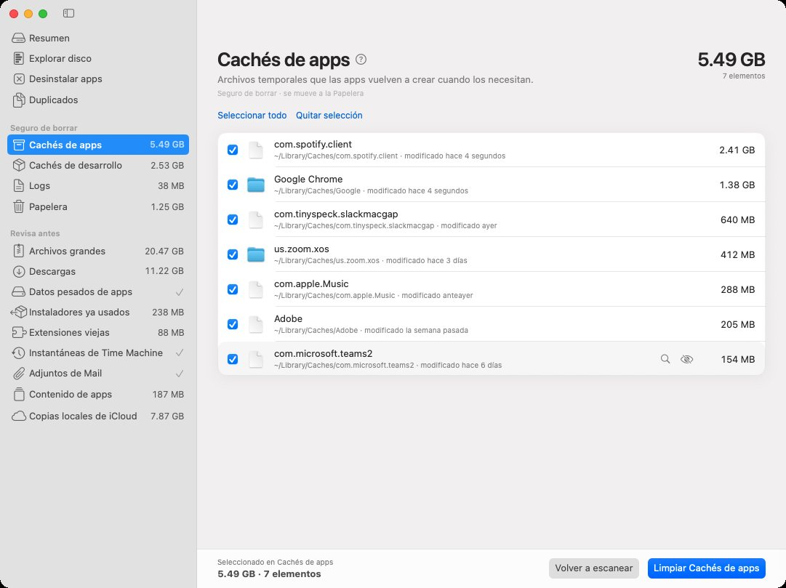
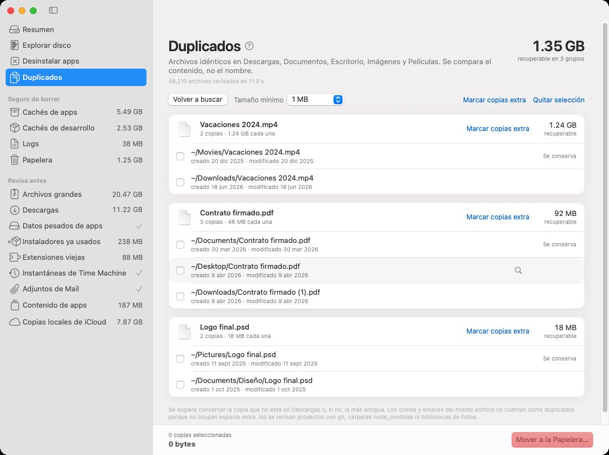
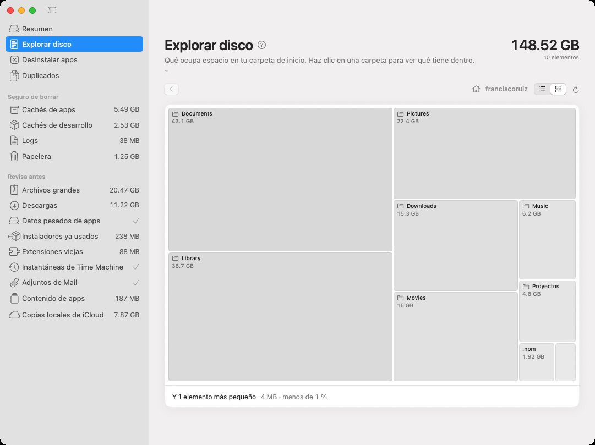
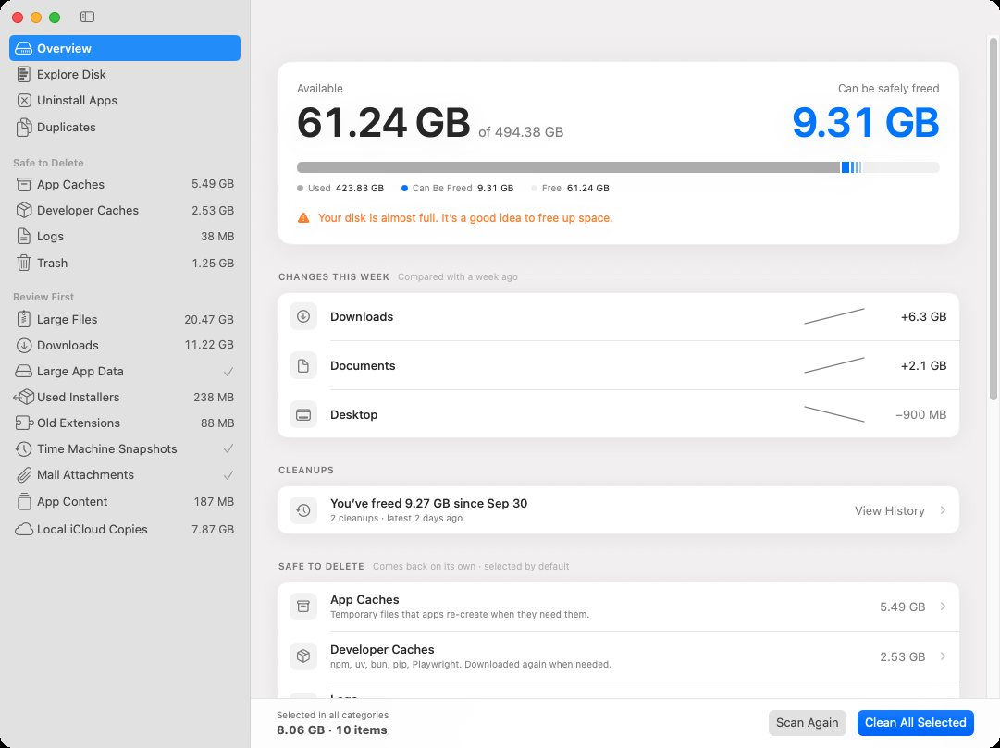

  

<h1 align="center">Mac Cleaner</h1>

  Libera espacio en tu Mac sin miedo a borrar algo importante. 
  Gratis, sencilla y en español.

  <a href="https://github.com/chisko/mac-cleaner-releases/releases/latest"><b>⬇︎ Descargar la última versión</b></a>
  &nbsp;·&nbsp; macOS 15 o posterior · Apple Silicon e Intel

---

## Qué hace

Mac Cleaner vive en la barra de menú, te dice cuánto espacio te queda y qué lo está ocupando, y te ayuda a liberarlo.

- **Encuentra lo que ocupa espacio**: cachés de apps, descargas viejas, archivos enormes que no abres hace meses, instaladores que ya usaste, episodios de Podcasts, fotos y videos de WhatsApp, adjuntos de Mail, copias locales de iCloud y más.
- **Separa lo seguro de lo que conviene revisar**: los cachés que las apps vuelven a crear vienen seleccionados; tus archivos, nunca.
- **Nunca borra nada sola.** Todo pasa por una confirmación y, de fábrica, va a la **Papelera**, así que se puede recuperar.
- **Te avisa** cuando el disco se está llenando o cuando una carpeta crece mucho.
- **Desinstala apps** junto con los archivos que dejan escondidos.
- **Encuentra duplicados** comparando el contenido, no el nombre.
- **Explora el disco** en lista o en un mapa visual, incluidos discos externos.
- Trae un **manual integrado**, funciona en **español e inglés** y **se actualiza sola**.

### Revisar antes de limpiar

Cada categoría explica qué contiene y qué pasa al limpiarla. El botón solo limpia lo que estás viendo.

### Duplicados

### Explorar disco

## Cómo instalarla

1. [Descarga el archivo `.dmg`](https://github.com/chisko/mac-cleaner-releases/releases/latest) más reciente (en **Assets**).
2. Ábrelo y arrastra **Mac Cleaner** a la carpeta **Aplicaciones**.
3. Ábrela. Aparece un ícono de destellos ✦ en la barra de menú, arriba a la derecha.
4. Para que pueda revisar todo, ve a **Ajustes de Mac Cleaner → General → Acceso total al disco → Abrir Ajustes…** y activa Mac Cleaner.

Está firmada y notarizada por Apple: al abrirla la primera vez solo verás el aviso normal de "descargada de internet". Las siguientes versiones se instalan solas: la app te avisa cuando hay una nueva.

## Preguntas frecuentes

**¿Es segura?** No borra nada sin que lo confirmes, y con el modo seguro (activado de fábrica) todo va a la Papelera. Lo que se ofrece como "seguro de borrar" son archivos que las apps vuelven a crear solas.

**¿Por qué pide "Acceso total al disco"?** macOS protege carpetas como la Papelera, Mail o los datos de otras apps. Sin ese permiso la app funciona, pero ve menos.

**¿Manda mis datos a algún lado?** No. Todo se revisa en tu Mac; lo único que consulta en internet es si hay una versión nueva.

---

<b>English</b>

**Mac Cleaner** is a free menu bar app that shows what's taking up space on your Mac and helps you free it up safely: app caches, old downloads, large files you haven't opened in months, used installers, duplicates, Podcasts episodes, WhatsApp media, Mail attachments, local iCloud copies and more. It never deletes anything without your confirmation, sends items to the Trash by default, includes a built-in manual, works in English and Spanish, and updates itself.

[Download the latest version](https://github.com/chisko/mac-cleaner-releases/releases/latest) (macOS 15 or later, Apple Silicon and Intel), open the `.dmg`, drag Mac Cleaner to Applications and grant Full Disk Access in its Settings.

